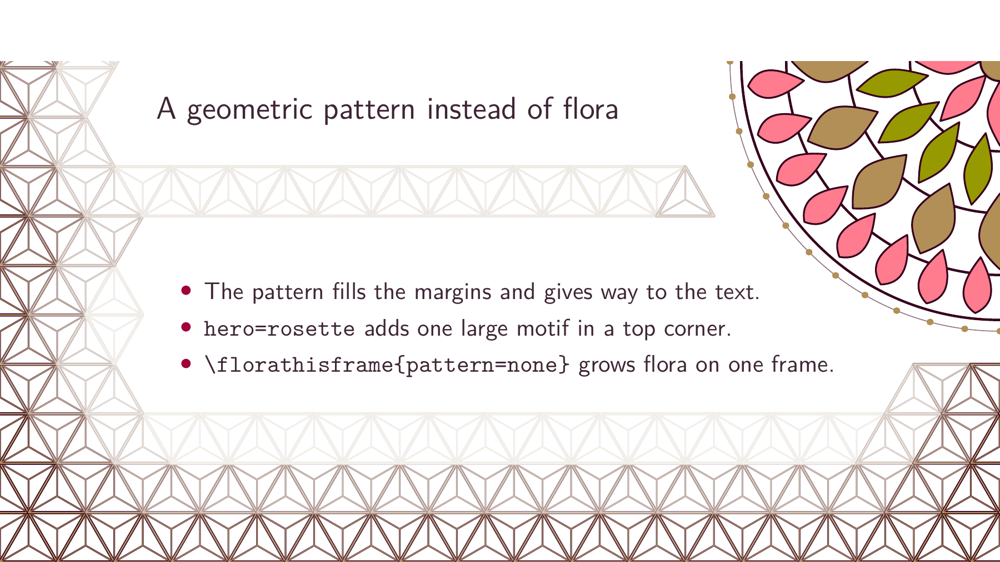
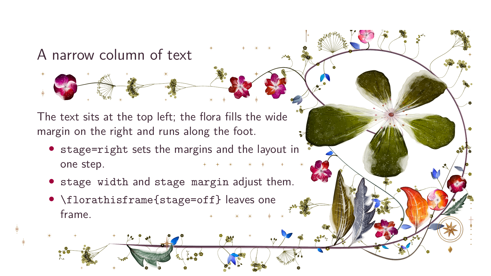

# beamer-floral

Procedural watercolour flora for [beamer](https://ctan.org/pkg/beamer),
drawn by [tikz-flora](https://github.com/wn-mitch/tikz-flora). Each slide
gets its own generated plant; the text block is measured so the flora
grows around the content and the margin follows the page.


```tex
\documentclass{beamer}
\usetheme{floral}
\begin{document}
\begin{frame}{Floral}
  The border grows around the text.
\end{frame}
\end{document}
```

Compile with `latexmk -lualatex`. The [tour](docs/src/tour.tex) is a complete
presentation of the package, written with it.

## Getting started

You need LuaLaTeX and the engine,
[tikz-flora](https://github.com/krissen/tikz-flora). This package uses
integration hooks that are not in the upstream engine yet; they are
[proposed upstream](https://github.com/wn-mitch/tikz-flora/issues/2). Until
they land, use the `beamer-floral` branch of the fork, commit `8123ec2` or
later. The options below all take care of that.

### From the release archive

The simplest way. Download `beamer-floral-v0.1.0.zip` from the
[latest release](https://github.com/krissen/beamer-floral/releases/latest),
which includes a matching engine. Unzip it, put your document in the
`beamer-floral` folder and compile:

```sh
latexmk -lualatex slides.tex
```

The folder has working examples: `example.tex` for static flora and
`growth-example.tex` for growth.

### On Overleaf

Upload the ZIP as a new project, set the compiler to LuaLaTeX and choose your
main document. Static flora, overlay growth and vector playback compile
directly. [Raster playback](#growing-flora) needs a cache built locally.

### From a Git checkout

Clone this repository and the engine's `beamer-floral` branch, then point TeX
at both when you compile:

```sh
git clone https://github.com/krissen/beamer-floral
git clone -b beamer-floral https://github.com/krissen/tikz-flora
TEXINPUTS=$PWD/beamer-floral:$PWD/tikz-flora/tex//: \
  FLORA_LUA=$PWD/tikz-flora/lua latexmk -lualatex slides.tex
```

To work on the package itself, put `TIKZFLORA=/path/to/tikz-flora` in a
gitignored `.env`; the repository's `latexmkrc` reads it.

### Where to go next

- [Settings](#settings): layout, density, seed, mix and palettes
- [Choosing the composition](#choosing-the-composition): recipes for common looks
- [Growing flora](#growing-flora): growth across overlays and timed playback
- [Reusing one drawing](#reusing-one-drawing): faster builds and smaller PDFs for long decks
- [With a stock theme](#with-a-stock-theme): keep Madrid, Berlin or your own theme
- [Reserving space](#reserving-space): keep flora away from a logo or footline
- [File size](#file-size): what to expect before you email a PDF
- The [manual](docs/beamer-floral.tex) and the
  [tour](https://github.com/krissen/beamer-floral/releases/latest/download/beamer-floral-tour.pdf), a
  presentation of the package written with it

## Use

`\florasetup{...}` sets the document; `\florathisframe{...}` the next painted
frame, including all its overlays. `\florathispage` is an alias with the same
frame semantics in Beamer. The engine's article API keeps its page semantics.
`\floraon` and `\floraoff` switch the painting off or on before a frame; a
theme may also switch margins with them, which is how title and section
pages keep plain margins.

`\usetheme{floral}` and `\usepackage{beamer-floral}` both reserve 2.5 cm on
the left and 1 cm on the right by default. These are the package's floral
margins, not Beamer's narrower inherited margins. The latter give the border
too little room and should be avoided. To customise the space, call
`\setbeamersize` after loading the theme or package.

Theme authors that restore a pre-floral layout on undecorated frames should
capture that layout before requiring `beamer-floral`, since loading it
establishes the floral margins.

By default, the flora stays fixed through a frame's overlays. The package collects the
union of their measured text regions and the displayed overlay count in a `.floral-cache` file beside the
build outputs. LuaLaTeX requests a rerun when the geometry or overlay count changes;
`latexmk` runs the necessary passes. On a first uncached run the decoration
is provisional. Keep floral settings, reservations, margins and on/off state
constant within a frame; change them before the next frame. An `againframe`
replay gets a new garden, and `allowframebreaks` continuations each get their
own. Split-layout parity follows those logical frame invocations rather than
the overlay page counter. Settings queued while flora is off remain pending
until a frame is painted.

## Growing flora

Opt in to growth across overlays:

```tex
\florasetup{growth=overlays}
```

Displayed overlay `k` of `N` shows approximately `k/N` of the finished
painted area. Leaves and flowers expand as whole shapes from their
attachments; stems extend before their foliage. A frame with one displayed
overlay shows its complete decoration. Skipped overlay numbers do not count
as stages. The final composition, seed and protected text regions stay fixed.
The first run is provisional; let `latexmk` converge after editing overlays.
An error reports compositions whose growth resolution cannot support the
requested number of distinct stages.

**Only raster playback needs a render cache.** `growth=overlays` is a
manual reveal as you step through slides and requires neither a render cache,
Python, Poppler nor `animate`. `growth=off` keeps ordinary static flora.

For vector playback (`growth=timed`), load the optional package in the preamble:

```tex
\usepackage{beamer-floral-animation}
\florasetup{growth=timed, growth duration=8, growth fps=20}
% Or select playback for one frame:
\florathisframe{growth=timed, growth duration=4, growth fps=15}
```

The default vector path uses ordinary `latexmk` and requires no Python,
Poppler or render cache. Detailed watercolour vectors can play unevenly in
Reader even at a requested high fps.

For smoother playback, explicitly opt in to raster caching:

```tex
\usepackage[raster]{beamer-floral-animation}
```

**Extra build dependencies apply only to this raster playback option.**
Install Python 3.9 or later and Poppler's `pdftocairo`, in addition to the
usual LuaLaTeX, `latexmk` and `animate`. They must be on `PATH`. Build with:

```sh
python3 tools/build_animation.py --outdir build/slides slides.tex
```

The builder runs LaTeX to measure the document, renders missing background
samples and builds the final PDF. It reuses existing samples on later builds.
There is no shell escape. The external tools are needed **when creating or updating
the cache for raster playback only**; viewing the PDF needs no Python or Poppler.
The builder's measurement PDF is an intermediate product: on cache misses it
collects geometry and the animation manifest without painting flora. LaTeX
still runs until cross-overlay geometry and page layout stabilize. The worker
then validates growth stages and exports missing samples before the final PDF
is built. Valid raster caches require no growth planning during LaTeX passes.
With `[raster]`, ordinary `latexmk` reports an error when the cache is
missing or stale and tells you to run the builder. It never silently uses
old frames. Changing geometry, seeds, engine sources, overlay counts or the
sample grid invalidates the affected cache.

The cache lives beside the build outputs in `<job>.floral-animation/`; keep
it with the document when moving to another machine. Cold builds need extra
time and temporary disk space, and cached samples consume disk space. Moving
flora is rasterized at 144 dpi by default (`--dpi 36..600` changes this),
including interval boundaries and static posters. Text and links remain
ordinary vector PDF content. The static and printed floral endpoint uses the
same raster image as playback, avoiding a vector redraw when playback stops.
Handout mode always uses complete static flora and needs no render cache.

`\usepackage[vector]{beamer-floral-animation}` explicitly selects the default
vector path. Neither this path nor manual overlay reveals need the external
raster tools.

### GIF playback for viewers without JavaScript

Viewers such as pympress cannot run the JavaScript of `animate`. For them,
select GIF playback:

```tex
\usepackage[gif]{beamer-floral-animation}
\floralgifmatte{FFFFFF} % optional: the page colour, six hex digits
```

Every `growth=timed` interval is then built from the raster cache as a GIF
and played by a full-page Screen annotation, with no `animate` environment
and no JavaScript in the PDF. `gif` includes `[raster]`, so the builder and
its requirements above apply. It also needs
[Pillow](https://pypi.org/project/pillow/) when it builds GIFs
(`python3 -m pip install pillow`). The build is the same:

```sh
python3 tools/build_animation.py --outdir build/slides slides.tex
```

By default the GIFs are **embedded in the PDF**, which is then
self-contained. That costs about 1 MB per second of animation at 20 fps and
144 dpi (8 s measured: 8.5 MB). With `[gif-external]` the PDF stays small and
plays the GIFs from files instead, in a Movie annotation. Keep
`<job>.floral-animation/` beside the PDF then, and move them together; a PDF
without them plays nothing.

The frames are composited against `\floralgifmatte` (default `FFFFFF`), so
set it to your page colour; pixels that are almost fully transparent stay
transparent. GIF files are named by interval, frame rate, matte colour and
encoder version, and are reused on later builds.

Limits:

- GIF frames are thinned above 50 fps effective rate (`growth fps` times
  the rounding of steps per interval can exceed it): every k-th sample is
  kept, with the first and last always present. Viewers that decode GIFs with
  GdkPixbuf, as pympress does, play any frame delay below 2 centiseconds as 20 ms
  (and a zero delay as 100 ms), so faster frames would play too slowly.
  An interval shorter than 20 ms plays in 20 ms.
- The GIF is an annotation above the page, not page content. Reservations
  (`\florareserve`) are applied to it: every pixel inside a reserved rectangle
  is transparent in every frame, rounded outward to whole pixels. Because the
  GIF plays above all page content, reserve areas that hold a logo or footline.
- Soft flora edges are matted against `\floralgifmatte`, not against what is
  under them. Over a coloured background band, set the matte to the band's colour
  or accept a light halo.
- Playback is verified in pympress 1.8.6. Viewers that do not play these
  annotations show each interval's start state, not the finished flora.
- Each interval plays once. Returning to a page does not replay it.
- Print or export from handout mode (it paints complete static flora).

Overleaf can compile static flora, manual reveals and vector playback directly.
For cached timed playback, build the cache locally first and upload it with
the document; rebuild locally after changes that invalidate it. The external
raster builder is not part of an ordinary Overleaf LaTeX compile.

Each overlay plays its own growth interval, starts automatically on page
entry, plays once and stops at its endpoint. Returning to a page restarts
that interval. Advancing early starts the next page at its nominal starting
stage. Duration is the total active growth time across the frame, divided
equally among its displayed overlays; time waiting between clicks is excluded.
A single title page animates the whole plant. **Text is visible from the start**;
only the background flora plays an animation.

`growth` accepts `off` (default), `overlays` or `timed`. `growth duration`
is a positive finite number of seconds (default 8). `growth fps` is an integer
from 1 to 60 (default 20); the frame count is rounded and the playback rate
adjusted so each interval contains both endpoints. Playback follows elapsed
time and skips late samples when a viewer cannot keep up.
Document settings are inherited; `\florathisframe` applies to the whole frame
and does not affect the next one. Use `\florathisframe{growth=off}` for a
complete static decoration.

Animation uses `animate` with `method=ocg` behind ordinary Beamer text,
links and numbering, with no mouse controls. The interval's final stage is
the static poster, including in viewers without JavaScript. Handout mode
always paints complete static flora and needs no animation support package.
Ordinary documents do not load `animate`.

The [animate manual](https://tug.ctan.org/macros/latex/contrib/animate/animate.pdf)
documents OCG playback in desktop Acrobat Reader and Okular. We have checked
playback in desktop Acrobat Reader; Okular is untested. Viewers that cannot
play the animation show the finished flora. See [the timed example](docs/src/growth.tex)
and [the acceptance checklist](test/acceptance/growth.md).

## Reusing one drawing

Flora normally adapts to each frame: it grows into the room the text leaves
and around the frame title, so every frame gets its own drawing. For a long
deck, `reuse` draws one picture per page class instead and puts it on every
page of that class:

```tex
\florasetup{reuse=content}            % ordinary frames share one drawing
\florasetup{reuse=all}                % title, section and content pages
\florasetup{reuse={title, section}}   % any combination
\florathisframe{reuse=none}           % this frame adapts as usual
```

Title pages are those that call `\titlepage`, and section pages those that
call `\sectionpage`, in any theme. A reused drawing keeps the whole text
block clear and does not measure the content. Frames with a title share one
drawing per title height (one line, two lines), and frames without one share
another. A different reservation, `\florathisframe` setting or page geometry
gives that frame its own drawing, which later frames with the same settings
reuse. Growing frames keep their own drawings, and so does a frame that an
integration draws with its own `render_page` callback. Pattern frames keep
their own drawings too (see [Patterns](#patterns)). The drawing is cached with the
other flora, so later compiles do not draw it again.

What you give up:

- Flora no longer fills the empty space inside short frames; it stays in the
  margins.
- Every page of a class looks the same.
- On titled frames the top edge carries no flora, since the title's width is
  not measured.
- With `title` in the list, the title page is much plainer than its usual
  full composition. `reuse=content` leaves title pages as they are.

Measured with `tools/measure_reuse.py` on `test/reuse-benchmark.tex`
(16:9, floral theme). A warm build is a second full `latexmk` compile of the
unchanged document with the flora caches kept; a cold build starts from an
empty output directory.

| Deck | Adaptive | `reuse=content` | `reuse=all` |
|---|---:|---:|---:|
| Title and 10 frames of two overlays, 21 pages | 19.4-19.8 s, 21.5 MB | | 3.8-3.9 s, 3.3 MB |
| Title and 40 one-overlay frames, 41 pages | 4.7-5.1 s, 62.2 MB | 4.4-6.1 s, 8.6 MB | 4.2-4.3 s, 3.4 MB |
| Title and 30 frames of three overlays, 91 pages | 60.3 s, 48.9 MB | | 5.5-5.6 s, 3.4 MB |
| As above with 6 section pages, 97 pages | 92.6-95.5 s, 57.0 MB | 12.8-13.0 s, 16.6 MB | 12.7-12.8 s, 4.7 MB |

Warm builds; cold builds take 30-34 s, 38-49 s, 77 s and 121-125 s adaptive
against 5.5-5.6 s, 6.2-6.4 s, 7.5-7.8 s and 15.2-15.5 s with `reuse=all`. Beamer
without floral takes 3.2-3.6 s on the 21-page deck, and the 97-page deck
takes about 12 s with flora off.
Measured with TeX Live 2025 and tikz-flora `cc3fb48`.

## Patterns

The engine can fill a page with a geometric pattern instead of flora. The
keys go in `\florasetup` or `\florathisframe`, like any other setting:

```tex
\florasetup{pattern=asanoha, edge=fade, hero=rosette}
\florathisframe{pattern=seigaiha, outer=margin, scale=1.5}   % this frame only
\florathisframe{pattern=none}                                % flora on this frame
```



`pattern` names a pattern or a group, `edge` how the pattern meets the text,
`hero` adds one large motif in a top corner, `outer` how it meets the paper's
edge and `scale` sets the cell size. The catalogue of patterns, groups and
values is in the [engine's README](https://github.com/krissen/tikz-flora#patterns)
and is not repeated here. Without a `pattern` key the flora is unchanged.

Measured with `tools/measure_reuse.py` on `test/reuse-benchmark.tex` (16:9,
floral theme, `PATTERN=asanoha` for the pattern decks, no `reuse`). Cold
builds, with the PDF size; the machine was shared and its load average
was 6-10 during the runs, so times carry some noise.

| Deck | Flora | `pattern=asanoha` |
|---|---:|---:|
| Title and 10 frames of two overlays, 21 pages | 31.3 s, 21.5 MB | 5.6 s, 0.18 MB |
| Title and 40 one-overlay frames, 41 pages | 49.0 s, 62.2 MB | 7.9 s, 0.65 MB |
| Title and 30 frames of three overlays, 6 section pages, 97 pages | 173 s, 57.0 MB | 44.6 s, 0.72 MB |

Pattern pages are small vector drawings, so the file stays small without
`reuse`. A frame with overlays is painted again rather than
taken from the engine's page cache, which is why the last deck takes longer
than the second although it has fewer frames.
Measured with TeX Live 2025 and tikz-flora `8123ec2`.

Patterns work with the rest of the theme:

- `growth=overlays` and `growth=timed` grow the pattern through the same
  progression as flora, with `hero` growing ring by ring from its centre.
  Cached raster playback keys on every pattern setting, so changing one
  rebuilds the samples.
- Pattern frames keep their own drawing under `reuse`. A reused drawing keeps
  the whole text block clear, which leaves a pattern almost nothing to fill,
  and a pattern is small and quick to draw without it (see the measurements
  below). A frame with `\florathisframe{pattern=none}` is a flora frame and is
  reused as usual.

## File size

Flora is detailed artwork, so even a static deck is far larger than plain
Beamer. Overlays of a static frame share one copy of the flora; growing flora
needs a separate drawing for each stage. These figures come
from `tools/measure_sizes.py`, which builds `test/size-benchmark.tex` with
identical content in each variant: a title page and ten frames of two
overlays, 21 PDF pages in all. Timed variants use the defaults of 8 seconds
and 20 fps, and raster samples are 144 dpi.

| Variant | PDF size |
|---|---:|
| Beamer without floral | 0.05 MB |
| `growth=off` | 21.5 MB |
| `growth=overlays` | 46.6 MB |
| `growth=timed`, vector | 68.4 MB |
| `growth=timed`, raster | 137.0 MB |

Measured with TeX Live 2025 and tikz-flora `ff21877`. Your own figures will
depend on the density, layout and number of pages. A raster build also keeps
its sample cache on disk, 102 MB for this document. Share a talk with
`\florasetup{growth=off}` if size matters more than the animation.

## Standalone bundle

Build a self-contained ZIP with its exact engine revision and verify its
extracted example without local development paths:

```sh
python3 tools/dist.py --engine /path/to/tikz-flora --test
```

The output is `build/beamer-floral.zip`. Unzip it, keep the supplied styles,
`beamer-floral.lua`, engine boot file and `lua/` beside your document, and
compile with LuaLaTeX. Both packages' licences and engine acknowledgements
are included. Publishing the archive is a separate step.

## Screenshots

### The theme on its own


*Warm palette: a gold hero, warm blooms and earth foliage. The block accent
is momiji, the alert yama-budo and the example yama-guri.*


*Blue palette: blooms, leaves and leaflets in the iroshizuku blues. Alerts
use murasaki-shikibu and examples tsuki-yo.*


*Green palette: blue blooms with green foliage. Alerts use edo-murasaki and
examples chiku-rin.*


*A title page with the left layout: the flora fills the left margin and the
foot, leaving the right margin paper.*

The floral theme selects this fuller composition automatically for
`\titlepage`: `layout=left`, `density=2`, and leaf, leaflet, spray and bloom
weights of 3. Ordinary frames retain the document's settings. Override the
title preset with `\florathisframe{layout=...,density=...,mix={...}}` before
the title frame. This also applies to static titles; animation stays optional.
The first displayed overlay selects the preset for the whole frame: a title
shown only on a later overlay does not change the composition mid-frame.
See [the full animated title example](docs/src/growth-title.tex), which uses
the default eight-second duration and the optional raster cache.

### Layout and density


*`layout=left`: the flora grows in the left margin and across the top and foot; the right margin is paper.*


*`layout=surround`: the crown stops under the running head and the foot
closes the border.*


*`density=0.6`: more paper between the stems and blooms.*


*`density=2.0`: a fuller margin with the same layout and seed.*

## With a stock theme

Themes with sidebars or other theme content in the page margins, such as
Berkeley, are **not visually supported**: their margin panels can cover the
flora. The package warns when a Beamer sidebar is present. Prefer floral or a
theme with free side margins; alternatively switch the flora off on those
frames.

The package empties the `background canvas` template, since a filled canvas
would cover the flora. For a coloured page use `\pagecolor`. On a dark page
combine it with `\florasetup{backdrop=dark}` and light text colours.
With `show notes on second screen`, the notes panel covers the flora on that
side. In a `beamerarticle` document the floral commands do nothing.

Load the stock theme first and beamer-floral after it:

```tex
\usetheme{Madrid}
\usepackage{beamer-floral}
\florasetup{seed=3, density=1.2}
```

The package defaults to `header=body`: it measures the frame title and
starts the flora below it, while the stock theme keeps its own header,
block, alert and example colours. The border and stems are the floral
package's own.

Use `header=margin` when the theme leaves room in the left margin and you
want the hero beside the title instead:

```tex
\florasetup{header=margin, layout=surround}
```

`\usetheme{floral}` selects margin mode itself.


*Madrid keeps its blue header and block colours; the flora starts below the
frame title.*


*Berlin keeps its headline and footline; the flora fills the side margins
below the title.*


*The default theme with body mode: the border starts below the title.*

## Long titles


*A long title and supporting subtitle share the page with the border. This
page comes from the same English visual template used for acceptance tests.*

## Settings

| Key | Values |
|---|---|
| `layout` | `left`, `right`, `centered`, `split`, `title`, `surround` |
| `header` | `body`, `margin` |
| `seed` | a number, or `random` |
| `density` | `0`–`10` |
| `mix` | `{leaves=3, leaflets=2, ...}` |
| `visitors` | weight for bees, butterflies, birds, snails |
| `colourway` | `spring`, `summer`, `autumn`, `winter`, `ember`, `plum`, `rose`, `original` |
| `palette` | `{hero=gold, blooms=blue, ...}` |
| `spin` | re-pick random inks |
| `ornaments` | `{moon=2, night=0, ...}` |
| `tune` | engine overrides, e.g. `{compose={hero=0.295}}` |
| `reuse` | `none`, `all`, or a list of `title`, `section`, `content` |
| `stage` | `off` (default), `right`, `left` |
| `stage width` | a length, default `0.39\paperwidth` |
| `stage margin` | a length, default `12mm` |

Named palettes:

```tex
\florapalette{warm}         % gold, warm blooms, earth foliage
\florapalette{blue}         % gold hero, blue blooms and foliage
\florapalette{green}        % gold hero, blue blooms, green foliage
\florapalette{green-stems}  % as green, with green stems
```

With `\usetheme{floral}`, `\florapalette` also sets the block title,
alert, example and description-label colours. Alerts take a deeper ink
from the same family: yama-budo for warm, murasaki-shikibu for blue,
edo-murasaki for green. A stock theme keeps its own block colours.

## Choosing the composition

Start with `layout=left` or the package's `surround` default. `right`,
`centered` and `split` need enough room on each painted side: changing the
layout does not exchange the package's 2.5 cm left and 1 cm right margins.
Set deliberate custom margins after loading when exploring these layouts.
Use the demonstrated left-layout title page before trying `layout=title`;
that engine layout crowns measured text and is not selected by `\titlepage`.

### The stage



`stage` puts the text in a narrow column at the top of one side and gives
the flora the wide margin on the other side and the foot. It sets the text
margins and `layout=right` or `layout=left` in one step:

```tex
\florasetup{stage=right}                       % content frames from here on
\florathisframe{stage=left, stage width=60mm}  % this frame only
\florathisframe{stage=off}                     % this frame keeps the document margins
```

`stage width` is the margin on the decorated side (default `0.39\paperwidth`,
62 mm on 16:9 and 50 mm on 4:3), `stage margin` the text margin on the other
side (default `12mm`). Both take any length, such as `55mm` or `0.3\paperwidth`.

- `stage=off` returns to the margins the document had when it began, including
  your own `\setbeamersize`.
- The stage applies to content frames. Title pages and section pages, the
  frames that call `\titlepage` or `\sectionpage` (as `reuse` classifies them),
  keep their own composition and the document margins, unless the frame asks
  for the stage itself with `\florathisframe{stage=...}`. A title or section
  page that is built by another macro, or a frame given as `\frame{...}`, is
  staged by default; the package warns, and `\florathisframe{stage=off}`
  before the frame fixes it.
- Beamer reads the margins when a frame starts, and `\setbeamersize` works only
  in the preamble, so the stage assigns the margin and width registers
  directly at the start of each frame. A `\setbeamersize` in the preamble after
  `stage` is set does not apply to staged frames. Change `stage` between
  frames, not inside one.
- Stage frames keep `columns` inside the text block, as with the class option
  `onlytextwidth`; the frames after them keep the document's own setting. An
  explicit `[totalwidth=...]` on a staged frame still wins.
- `pattern` works on the stage: the pattern fills the
  wide margin and gives way to the text column.
- With `reuse`, a staged frame has its own page geometry and so its own shared
  drawing; frames on the document margins keep theirs.
- Sidebar themes are not supported, as before.

A quieter, foliage-led composition uses existing engine settings:

```tex
\florasetup{density=0.6, mix={leaves=2, bloom=0, soft=0, lily=0,
  ghost=0, umbel=0, cyme=0, gyps=0}}
```

A custom palette changes the flora; it does not automatically redefine the
Floral theme's block, alert or text colours. Set those with `\setbeamercolor`
when designing a custom colour scheme:

```tex
\florasetup{palette={hero=kon-peki, blooms=warm, leaves=teal}}
```

`ornaments={...}` adjusts the relative weights of registered ornament kinds,
not explicit positions. To suppress a whole slot, set every kind in that slot
to zero. For example, the header slot has four kinds:

```tex
\florasetup{ornaments={compass=0, rosette=0, sunburst=0, quatrefoil=0}}
```

Visitors are optional accents. Keep them sparse, for example
`\florasetup{visitors=0.2, mix={bird=0, snail=0}}`. With a fixed seed,
`palette={blooms=random}` and `spin=1` explore another ink without moving
stems or blossoms. Keep settings constant across a frame's overlays.

The engine's `\florasheet{3}` and `\floragallery[1]`, inside a
`tikzpicture`, are design reference sheets. Inspect them separately rather
than shrinking an entire sheet onto a presentation slide.

## Optional list markers and dividers


*The optional list templates use the same rosette at all three depths.
The current text size and Beamer item colour determine their appearance.*


*The divider is centred in the text block with a nominal width of half
the current line width.*

The Floral theme keeps circle markers by default. Select the optional
ornament templates independently:

```tex
\setbeamertemplate{itemize item}[floral]
\setbeamertemplate{itemize subitem}[floral]
\setbeamertemplate{itemize subsubitem}[floral]
\floralornamentsetup{item=gilt_rosette, subitem=gilt_rosette,
  subsubitem=gilt_rosette, width=.85em, height=.85em, baseline=.18em,
  seed=3, color=., divider=fleuron_rule, divider width=0.5\linewidth,
  divider height=1em, divider baseline=0pt, divider color=.,
  divider skip=\medskipamount}
```

These are the defaults: all three list depths use the same rosette.
Set `subitem=gilt_trefoil` or `subsubitem=gilt_lozenge`, for example,
to choose other forms independently. `\floraldivider` inserts a centred ornament with
space above and below. Dimensions are nominal drawing-box dimensions;
the engine includes paint reach in the actual TeX box. The baseline is
measured above the nominal box bottom. `color=.` follows the current text
colour; explicit xcolor expressions are also accepted. Settings obey TeX
groups, so a local variant need not change later slides. Registered ornament
names are accepted, but detailed cartouches are unsuitable at bullet size.
The templates use the engine's isolated seed and do not change frame flora.

These commands belong to `\usetheme{floral}`. The generic package preserves
stock-theme list templates. For custom stock-theme integrations, the engine
also exposes `\floraornament[width=1em,height=1em,baseline=0pt,seed=1,color=.]{gilt_rosette}`.
The optional templates require tikz-flora commit `28c394a` or later.
See the [comparison fixture](test/visual/README.md#optional-ornament-comparison)
for visual review; these candidates do not establish projection readability.

### Alternative forms and colours


*Rosettes, trefoils and lozenges at the same nominal size. The lozenge has
finer strokes and needs particular care at projected size.*

After selecting the floral templates above, choose a shape with
`\floralornamentsetup{item=gilt_trefoil}` (or `gilt_rosette` or
`gilt_lozenge`). `item` changes the first depth; `subitem` and
`subsubitem` independently change the other depths.


```tex
\floralornamentsetup{item=rosette, subitem=gilt_trefoil,
  subsubitem=gilt_lozenge, color=blue!70!black}
```

*The header ornament `rosette` is a pointed form, distinct from the smaller
four-dot `gilt_rosette`. Explicit colours override the inherited Beamer ink.*


The first divider uses the defaults. The other two use:

```tex
\floralornamentsetup{divider=swash, divider width=.35\linewidth,
  divider height=1em, divider color=blue!70!black}
\floraldivider
\floralornamentsetup{divider=headpiece, divider width=.7\linewidth,
  divider height=1.2em, divider color=green!40!black}
\floraldivider
```

All three catalogue images come from the executable English
[configuration catalogue](test/visual/ornament-catalogue.tex).
Its background flora is disabled to make the individual shapes easy to compare.

## Reserving space

Keep the flora out of a rectangle with paper coordinates as dimensions, origin
at the lower-left corner:

```tex
\florareserve{0pt}{0pt}{\the\paperwidth}{\the\dimexpr 1cm\relax}
\floraclearreserve
```

This is useful for a footline, a logo or a caption. Reservations persist
until `\floraclearreserve`; set and clear them between frames, not between
overlays. They clip the flora and preserve the underlying background.
`\florabackground[bottom]{blue!10}{1cm}` adds a band before the flora;
use height `0pt` to disable it. A reservation protects content over that band.
Neither command measures a logo automatically.

## Development

See [CONTRIBUTING.md](CONTRIBUTING.md) for contribution and commit-message conventions.

```sh
latexmk -lualatex test/smoke.tex
```

CI checks out the pinned engine and builds the test documents, executable
documentation and integration fixtures with LuaLaTeX. The engine's own tests run in its
repository. The `tune` keys are validated by the engine against its tuner
index, so a typo names the key and its valid siblings.

Title, palette and stock-theme screenshots are exported from the visual
acceptance PDFs. Layout and density scenes come from the executable
documentation fixture `docs/src/showcase.tex`, which is also compiled in CI.

For visual acceptance across title lengths, themes and aspect ratios, use the
reusable [visual template](test/visual/README.md):

```sh
python3 tools/visual_suite.py --engine ../tikz-flora
```

This produces comparison PDFs, a page guide, contact sheets and build
diagnostics under `build/visual-review/`. Stock-theme warnings trigger matching
builds without floral to help identify regressions. Inspect the output before
approving changes; compilation success alone is insufficient.

Use `--screenshots docs/img` to refresh all documentation screenshots from
those acceptance and documentation PDFs. All example content is English.

To compare raster build cost, freeze an engine tree outside your working
checkout and run:

```sh
python3 tools/measure_raster_build.py --engine ../frozen-engine
```

This builds the dense title and slideshow fixtures cold and then warm, and
writes step times, memory and disk use to
`build/raster-measurements/results.json`.

## Licence

MIT; see [LICENSE](LICENSE). The engine dependency retains its own MIT
licence and acknowledgements.
