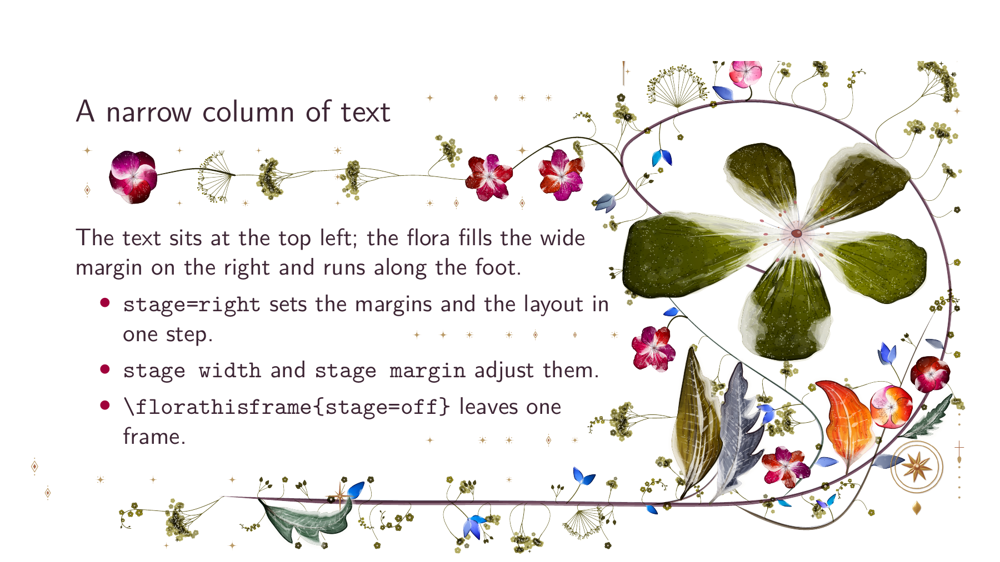
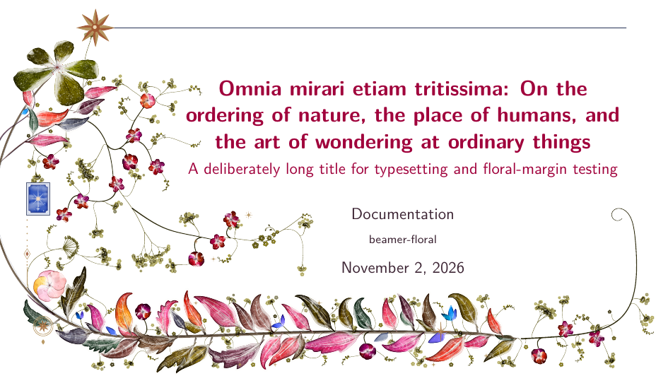

# Layout and page types

The stage, the optional section page, long titles, the running-head mark and
reserved space.

## The stage



`stage` puts the text in a narrow column at the top of one side and gives
the flora the wide margin on the other side and the foot. It sets the text
margins and `layout=right` or `layout=left` in one step:

```tex
\florasetup{stage=right}                       % content frames from here on
\florathisframe{stage=left, stage width=60mm}  % this frame only
\florathisframe{stage=off}                     % this frame keeps the document margins
```

`stage width` is the margin on the decorated side (default `0.39\paperwidth`,
62 mm on 16:9 and 50 mm on 4:3), `stage margin` the text margin on the other
side (default `12mm`). Both take a positive length such as `55mm` or
`0.3\paperwidth` (the accepted units are listed under [Settings](settings.md#keys-and-palettes)).

- `stage=off` returns to the margins the document had when it began, including
  your own `\setbeamersize`.
- The stage applies to content frames. Title pages and section pages, the
  frames that call `\titlepage` or `\sectionpage` (as `reuse` classifies them),
  keep their own composition and the document margins, unless the frame asks
  for the stage itself with `\florathisframe{stage=...}`. A title or section
  page that is built by another macro, or a frame given as `\frame{...}`, is
  staged by default; the package warns, and `\florathisframe{stage=off}`
  before the frame fixes it.
- Beamer reads the margins when a frame starts, and `\setbeamersize` works only
  in the preamble, so the stage assigns the margin and width registers
  directly at the start of each frame. A `\setbeamersize` in the preamble after
  `stage` is set does not apply to staged frames. Change `stage` between
  frames, not inside one.
- Stage frames keep `columns` inside the text block, as with the class option
  `onlytextwidth`; the frames after them keep the document's own setting. An
  explicit `[totalwidth=...]` on a staged frame still wins.
- `pattern` works on the stage: the pattern fills the
  wide margin and gives way to the text column.
- With `reuse`, a staged frame has its own page geometry and so its own shared
  drawing; frames on the document margins keep theirs.
- Sidebar themes are not supported, as before.

## Section pages

The Floral theme has an optional section page. It sets the section name
where the title block sits, beside the flora, with the floral divider below
it, and takes a lighter version of the title page's composition:

```tex
\setbeamertemplate{section page}[floral]
\AtBeginSection[]{\begin{frame}[plain]\sectionpage\end{frame}}
```

- The template is not the theme's default. Without the first line,
  `\sectionpage` keeps Beamer's template, and a theme that defines its own
  section page keeps it; such pages get the document's ordinary composition.
- The theme adds no `\AtBeginSection` hook: the second line is the
  document's, and leaving it out gives section pages only where a frame
  calls `\sectionpage`. A plain frame, as here, starts the flora at the
  paper's top like the title page; a frame with a running head keeps it.
- The heading uses the font `floral section title`, which is `section title`
  at `\LARGE`, in the `section title` colour. `\floralornamentsetup` changes
  the divider, as anywhere else. The heading is offset from the left like the
  title block, by `\floratitleoffset` (1.8 cm by default; `\renewcommand`
  changes both).
- `\florathisframe` settings still win, and section pages keep the document
  margins under `stage` and share a drawing under `reuse=section`, as other
  section pages do.

## Long titles



*A long title and supporting subtitle share the page with the border. This
page comes from the same English visual template used for acceptance tests.*

## The running-head mark

Every frame of the floral theme carries a running-head mark, a small gilt
ornament at the top of the left margin. On a titled frame it sits above the
title, in a size that follows the room there: 20 to 22 pt over a one-line
title, 12 to 14 pt with a subtitle or over two lines.
`\florasetup{tune={gesture={mark_min=10}}}` sets the smallest mark drawn
(10 pt by default); with less room the mark is left out. The mark is drawn
whole or not at all: no kind, the compass with its crosshair included,
reaches above or below its square, so the top of the page never cuts it,
and beside a reservation (see [Reserving space](#reserving-space)) it takes
the largest whole mark that fits, lower down or smaller, or is left out. The
compass star is sized so that its crosshair, which reaches 1.3 times the
star's radius, ends inside the square. A plain frame has no running head, so
there the border and the mark start at the paper's top, as on the title
page. Pattern pages carry no mark.

## Reserving space

Keep the flora out of a rectangle with paper coordinates as dimensions, origin
at the lower-left corner:

```tex
\florareserve{0pt}{0pt}{\the\paperwidth}{\the\dimexpr 1cm\relax}
\floraclearreserve
```

This is useful for a footline, a logo or a caption. Reservations persist
until `\floraclearreserve`; set and clear them between frames, not between
overlays. They clip the flora and preserve the underlying background.
The running-head mark is never cut by one: it moves down or gets smaller
beside it, or is left out, and its rule stops short of it. One known limit:
on an untitled frame under a reservation in the top-left corner, the mark
moves down whole and can then lie over the bloom.
`\florabackground[bottom]{blue!10}{1cm}` adds a band before the flora;
use height `0pt` to disable it. A reservation protects content over that band.
Neither command measures a logo automatically.
