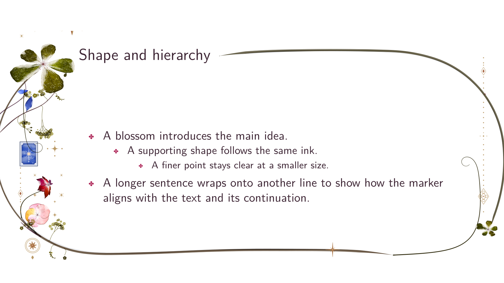
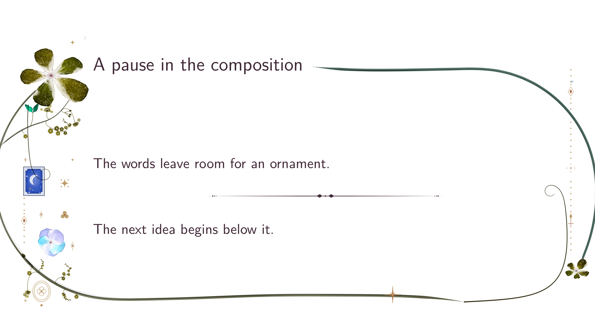
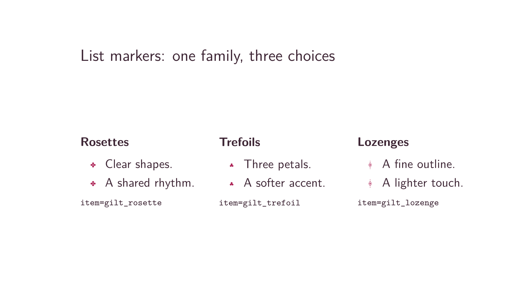
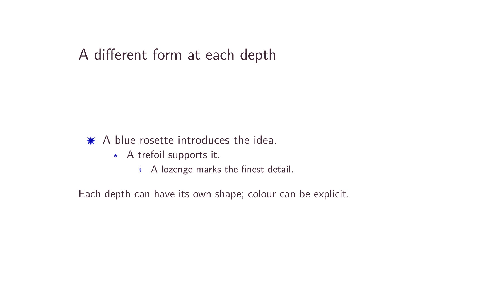
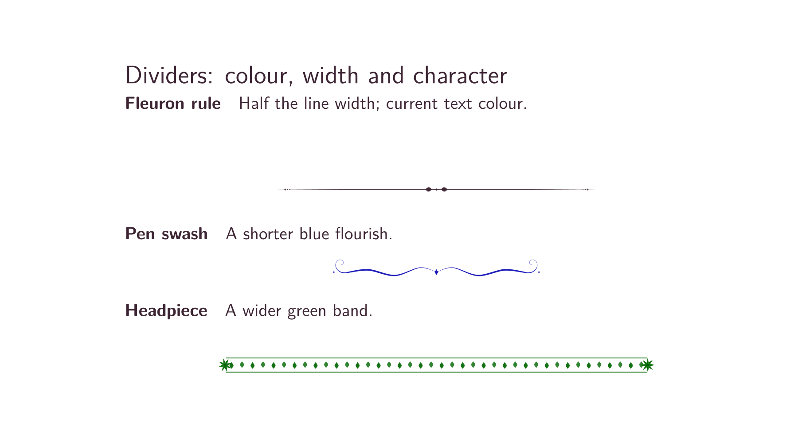

# Optional list markers and dividers



*The optional list templates use the same rosette at all three depths.
The current text size and Beamer item colour determine their appearance.*



*The divider is centred in the text block with a nominal width of half
the current line width.*

The Floral theme keeps circle markers by default. Select the optional
ornament templates independently:

```tex
\setbeamertemplate{itemize item}[floral]
\setbeamertemplate{itemize subitem}[floral]
\setbeamertemplate{itemize subsubitem}[floral]
\floralornamentsetup{item=gilt_rosette, subitem=gilt_rosette,
  subsubitem=gilt_rosette, width=.85em, height=.85em, baseline=.18em,
  seed=3, color=., divider=fleuron_rule, divider width=0.5\linewidth,
  divider height=1em, divider baseline=0pt, divider color=.,
  divider skip=\medskipamount}
```

These are the defaults: all three list depths use the same rosette.
Set `subitem=gilt_trefoil` or `subsubitem=gilt_lozenge`, for example,
to choose other forms independently. `\floraldivider` inserts a centred ornament with
space above and below. Dimensions are nominal drawing-box dimensions;
the engine includes paint reach in the actual TeX box. The baseline is
measured above the nominal box bottom. `color=.` follows the current text
colour; explicit xcolor expressions are also accepted. Settings obey TeX
groups, so a local variant need not change later slides. Registered ornament
names are accepted, but detailed cartouches are unsuitable at bullet size.
The templates use the engine's isolated seed and do not change frame flora.

These commands belong to `\usetheme{floral}`. The generic package preserves
stock-theme list templates. For custom stock-theme integrations, the engine
also exposes `\floraornament[width=1em,height=1em,baseline=0pt,seed=1,color=.]{gilt_rosette}`.
The optional templates require tikz-flora commit `28c394a` or later.
See the [comparison fixture](../../test/visual/README.md#optional-ornament-comparison)
for visual review; these candidates do not establish projection readability.

## Alternative forms and colours



*Rosettes, trefoils and lozenges at the same nominal size. The lozenge has
finer strokes and needs particular care at projected size.*

After selecting the floral templates above, choose a shape with
`\floralornamentsetup{item=gilt_trefoil}` (or `gilt_rosette` or
`gilt_lozenge`). `item` changes the first depth; `subitem` and
`subsubitem` independently change the other depths.



```tex
\floralornamentsetup{item=rosette, subitem=gilt_trefoil,
  subsubitem=gilt_lozenge, color=blue!70!black}
```

*The header ornament `rosette` is a pointed form, distinct from the smaller
four-dot `gilt_rosette`. Explicit colours override the inherited Beamer ink.*



The first divider uses the defaults. The other two use:

```tex
\floralornamentsetup{divider=swash, divider width=.35\linewidth,
  divider height=1em, divider color=blue!70!black}
\floraldivider
\floralornamentsetup{divider=headpiece, divider width=.7\linewidth,
  divider height=1.2em, divider color=green!40!black}
\floraldivider
```

All three catalogue images come from the executable English
[configuration catalogue](../../test/visual/ornament-catalogue.tex).
Its background flora is disabled to make the individual shapes easy to compare.
