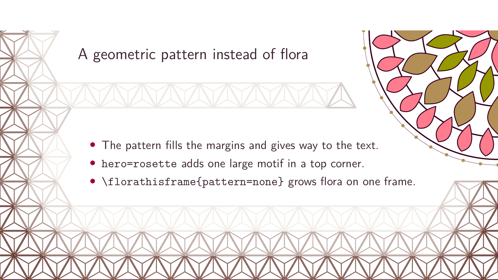

# Patterns

**Experimental.** Patterns are new in this package. Their appearance, keys
and values may change in a later version.

The engine can fill a page with a geometric pattern instead of flora. The
keys go in `\florasetup` or `\florathisframe`, like any other setting:

```tex
\florasetup{pattern=asanoha, edge=fade, hero=rosette}
\florathisframe{pattern=seigaiha, outer=margin, scale=1.5}   % this frame only
\florathisframe{pattern=none}                                % flora on this frame
```



`pattern` names a pattern or a group, `edge` how the pattern meets the text,
`hero` adds one large motif in a top corner, `outer` how it meets the paper's
edge and `scale` sets the cell size. The catalogue of patterns, groups and
values is in the [engine's README](https://github.com/krissen/tikz-flora#patterns)
and is not repeated here. Without a `pattern` key the flora is unchanged.

Pattern pages are small vector drawings, so the file stays small without
`reuse`. Measured build times and PDF sizes, flora against pattern, are in
[performance](../dev/performance.md#build-times-flora-and-patterns).

Patterns work with the rest of the theme:

- `growth=overlays` and `growth=timed` grow the pattern through the same
  progression as flora, with `hero` growing ring by ring from its centre.
  Cached raster playback keys on every pattern setting, so changing one
  rebuilds the samples.
- Pattern frames keep their own drawing under `reuse`. A reused drawing keeps
  the whole text block clear, which leaves a pattern almost nothing to fill,
  and a pattern is small and quick to draw without it (see
  [the measurements](../dev/performance.md#build-times-flora-and-patterns)). A
  frame with `\florathisframe{pattern=none}` is a flora frame and is reused
  as usual.
