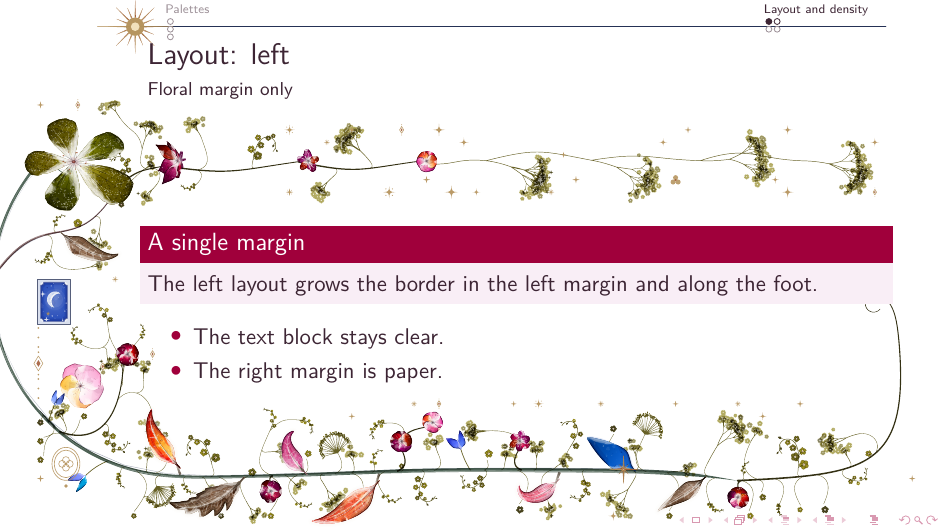
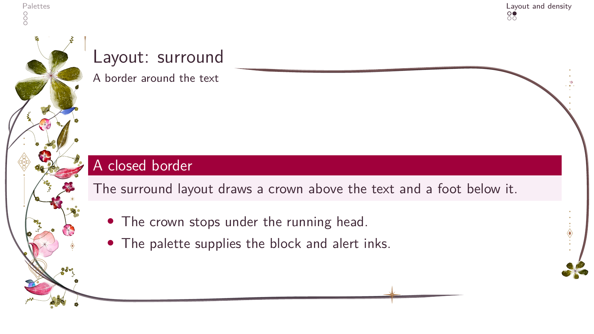
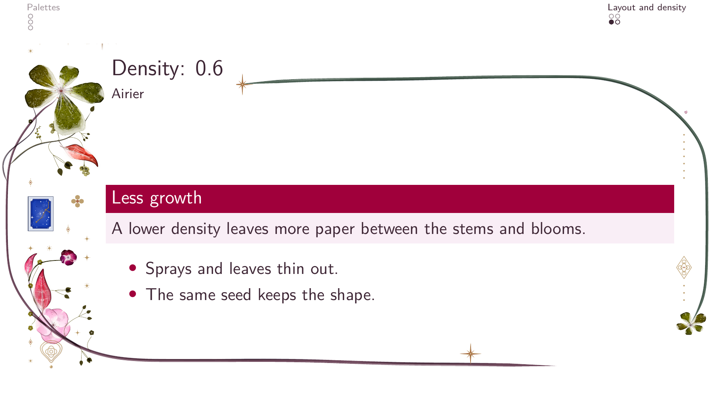
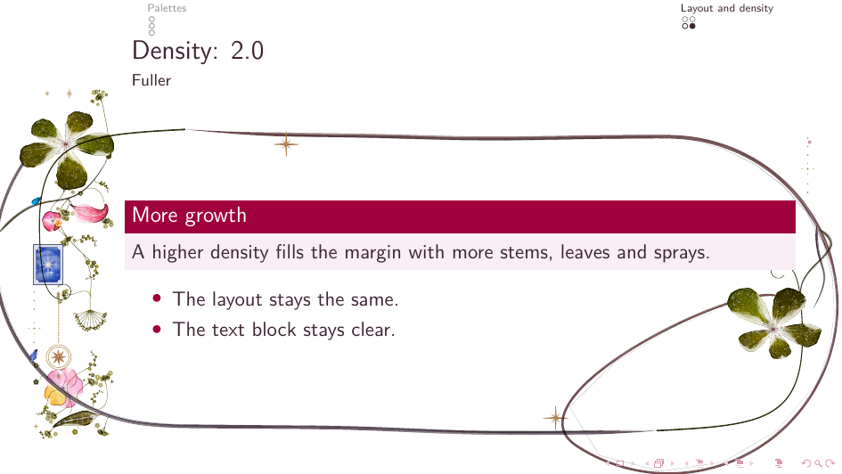

# Settings

The floral settings: how to set them, every key with its values and default,
the palettes, the composition and the layouts, and the files a build leaves
beside the PDF.

## Use

`\florasetup{...}` sets the document; `\florathisframe{...}` the next painted
frame, including all its overlays. `\florathispage` is an alias with the same
frame semantics in Beamer. The engine's article API keeps its page semantics.
`\floraon` and `\floraoff` switch the painting on or off before a frame; a
theme may also switch margins with them, which is how title and section
pages keep plain margins.

`\usetheme{floral}` and `\usepackage{beamer-floral}` both reserve 2.5 cm on
the left and 1 cm on the right by default. These are the package's floral
margins, not Beamer's narrower inherited margins. The latter give the border
too little room and should be avoided. To customise the space, call
`\setbeamersize` after loading the theme or package.

Theme authors that restore a pre-floral layout on undecorated frames should
capture that layout before requiring `beamer-floral`, since loading it
establishes the floral margins.

By default, the flora stays fixed through a frame's overlays. The package collects the
union of their measured text regions and the displayed overlay count in a `.floral-cache` file beside the
build outputs. LuaLaTeX requests a rerun when the geometry or overlay count changes;
`latexmk` runs the necessary passes. On a first uncached run the decoration
is provisional. Keep floral settings, reservations, margins and on/off state
constant within a frame; change them before the next frame. An `againframe`
replay gets a new garden and takes its stage from the settings at the replay, so
repeat a `\florathisframe{stage=...}` before it when the original frame had one;
and `allowframebreaks` continuations each get their
own. Split-layout parity follows those logical frame invocations rather than
the overlay page counter. Settings queued while flora is off remain pending
until a frame is painted.

A build leaves up to three caches beside the PDF (raster and GIF playback also write `<job>.floral-animation-manifest`). `<job>.floral-cache` holds
the measurements above. `<job>-flora/` is the engine's page cache: later
compiles embed each frame's flora from it instead of composing it again, also
for static frames with several overlays, and `\florasetup{cache=false}` turns
it off. `<job>.floral-animation/` holds the samples and GIFs of raster and GIF
playback (see [Growing flora](growth.md)).

## Keys and palettes

| Key | Values |
|---|---|
| `layout` | `left`, `right`, `centered`, `split`, `title`, `surround`, `flank`, `wreath`, `bouquet`, `scrollwork` (see [Layouts](#layouts)) |
| `header` | `body`, `margin` |
| `seed` | a number, or `random` |
| `density` | `0`–`10` |
| `mix` | `{leaves=3, leaflets=2, ...}` |
| `visitors` | weight for bees, butterflies, birds, snails |
| `colourway` | `spring`, `summer`, `autumn`, `winter`, `ember`, `plum`, `rose`, `original` |
| `palette` | `{hero=gold, blooms=blue, ...}` |
| `spin` | re-pick random inks |
| `ornaments` | `{moon=2, night=0, ...}` |
| `tune` | engine overrides, e.g. `{compose={hero=0.295}}` |
| `backdrop` | `light` (default), `dark`, or a dark `#rrggbb` |
| `cache` | `true` (default), `false`: keep each page's flora in `<job>-flora/` |
| `growth` | `off` (default), `overlays`, `timed` |
| `growth duration` | seconds, default `8` |
| `growth fps` | an integer from 1 to 60, default `20` |
| `reuse` | `none` (default), `all`, or a list of `title`, `section`, `content` |
| `stage` | `off` (default), `right`, `left` |
| `stage width` | a positive length, default `0.39\paperwidth` |
| `stage margin` | a positive length, default `12mm` |
| `pattern`, `edge`, `hero`, `outer`, `scale` | experimental; see [Patterns](patterns.md) |

`stage width` and `stage margin` take a number with one of the units `pt`,
`mm`, `cm`, `in`, `bp`, `pc`, `dd`, `cc`, `ex` or `em`, or a multiple of
`\paperwidth` or `\paperheight`.

Named palettes:

```tex
\florapalette{warm}         % gold, warm blooms, earth foliage
\florapalette{blue}         % gold hero, blue blooms and foliage
\florapalette{green}        % gold hero, blue blooms, green foliage
\florapalette{green-stems}  % as green, with green stems
```

With `\usetheme{floral}`, `\florapalette` also sets the block title,
alert, example and description-label colours. Alerts take a deeper ink
from the same family: yama-budo for warm, murasaki-shikibu for blue,
edo-murasaki for green. A stock theme keeps its own block colours.

## Layouts

The engine has ten layouts, set with `layout`:

- `left`: the left margin (the default of the engine; this package starts
  with `surround`).
- `right`: the right margin.
- `centered`: both side margins, with two different plants.
- `split`: the outer margin of a two-sided document. It is on the right of
  odd pages and the left of even ones.
- `title`: a crown over a title. Wrap the title in
  `\begin{floratitle} ... \end{floratitle}`; without it the first block
  of lines is crowned.
- `surround`: a wreath round the text block, for title pages and contents.
- `flank`: a plant up each side of the page's contents, their roots
  meeting at the foot round a crest.
- `wreath`: an open oval garland round the title, tied at its foot.
- `bouquet`: one upright bouquet tied with a bow, behind the title, with
  each title line on a ribbon.
- `scrollwork`: an oval gilt scroll frame round the title, with a crest at
  its head, scrolls at its foot and the flora twined over it.

The last four are for title pages. The oval of `wreath` and `scrollwork`
spans the page's width and keeps to the room between the title and the
nearest lines above and below it. Each of the four frames the lines in
`floratitle`, or the first block of lines without it. The
[engine's README](https://github.com/krissen/tikz-flora/blob/beamer-floral/README.md#layouts) describes them
in full.

## Choosing the composition

Start with `layout=left` or the package's `surround` default. `right`,
`centered` and `split` need enough room on each painted side: changing the
layout does not exchange the package's 2.5 cm left and 1 cm right margins.
Set deliberate custom margins after loading when exploring these layouts.
Use the demonstrated left-layout title page before trying `layout=title`;
that engine layout crowns measured text and is not selected by `\titlepage`.

A quieter, foliage-led composition uses existing engine settings:

```tex
\florasetup{density=0.6, mix={leaves=2, bloom=0, soft=0, lily=0,
  ghost=0, umbel=0, cyme=0, gyps=0}}
```

A custom palette changes the flora; it does not automatically redefine the
Floral theme's block, alert or text colours. Set those with `\setbeamercolor`
when designing a custom colour scheme:

```tex
\florasetup{palette={hero=kon-peki, blooms=warm, leaves=teal}}
```

`ornaments={...}` adjusts the relative weights of registered ornament kinds,
not explicit positions. To suppress a whole slot, set every kind in that slot
to zero. For example, the header slot has four kinds:

```tex
\florasetup{ornaments={compass=0, rosette=0, sunburst=0, quatrefoil=0}}
```

Visitors are optional accents. Keep them sparse, for example
`\florasetup{visitors=0.2, mix={bird=0, snail=0}}`. With a fixed seed,
`palette={blooms=random}` and `spin=1` explore another ink without moving
stems or blossoms. Keep settings constant across a frame's overlays.

The engine's `\florasheet{3}` and `\floragallery[1]`, inside a
`tikzpicture`, are design reference sheets. Inspect them separately rather
than shrinking an entire sheet onto a presentation slide.

## Layout and density



*`layout=left`: the flora grows in the left margin and across the top and foot; the right margin is paper.*



*`layout=surround`: the crown stops under the running head and the foot
closes the border.*



*`density=0.6`: more paper between the stems and blooms.*



*`density=2.0`: a fuller margin with the same layout and seed.*
