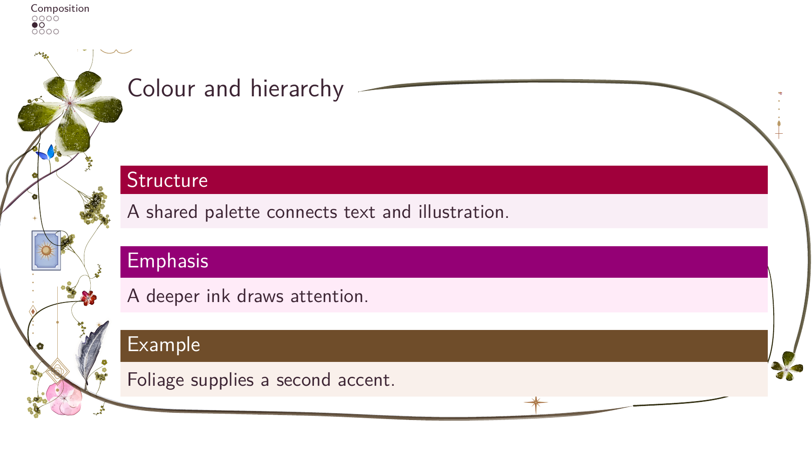
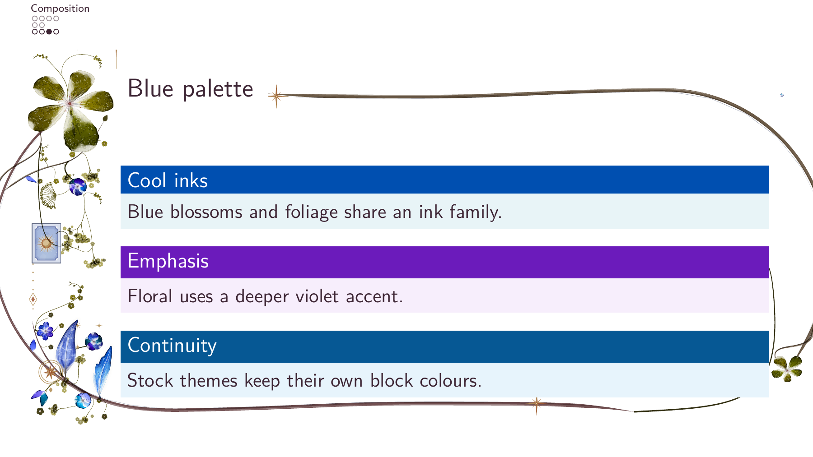
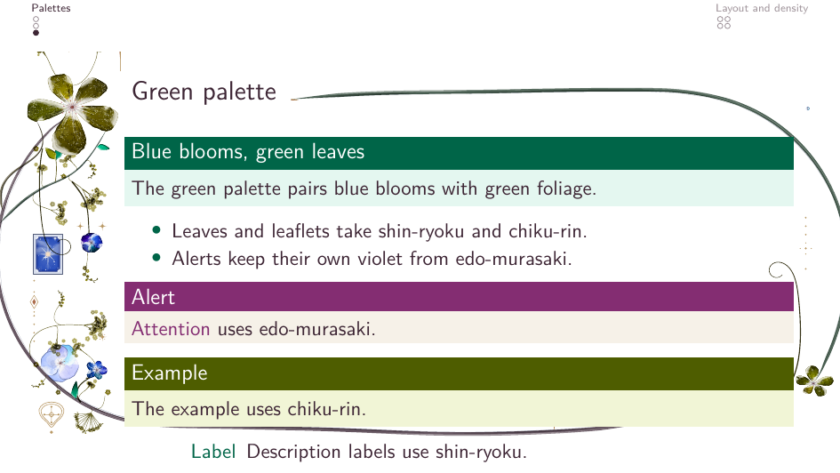
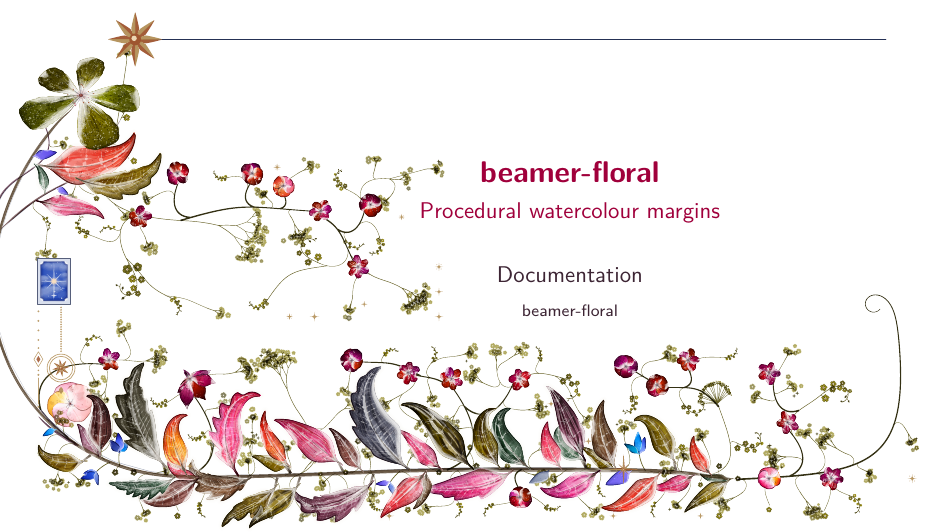
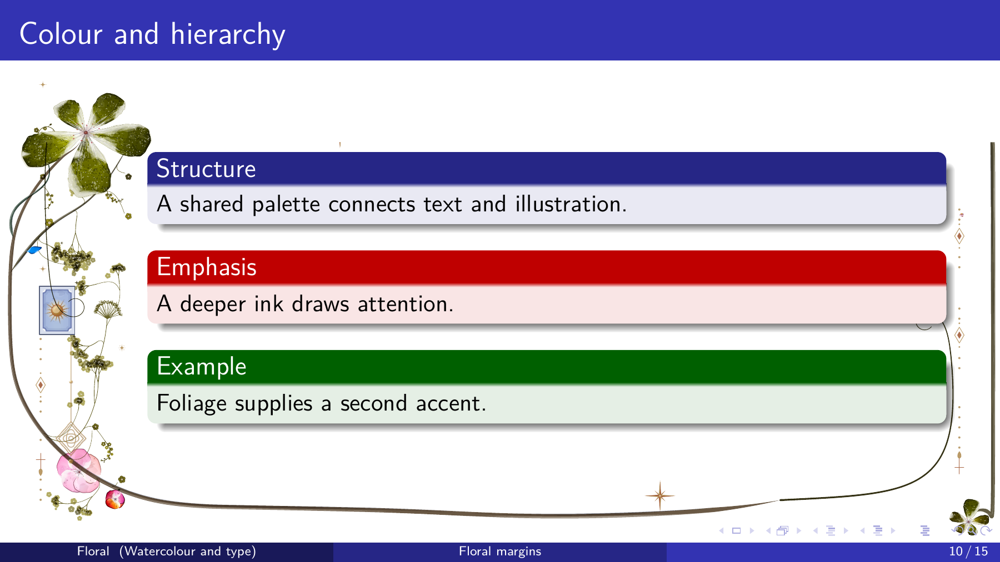
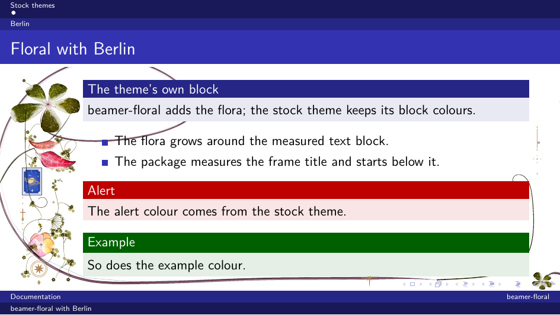
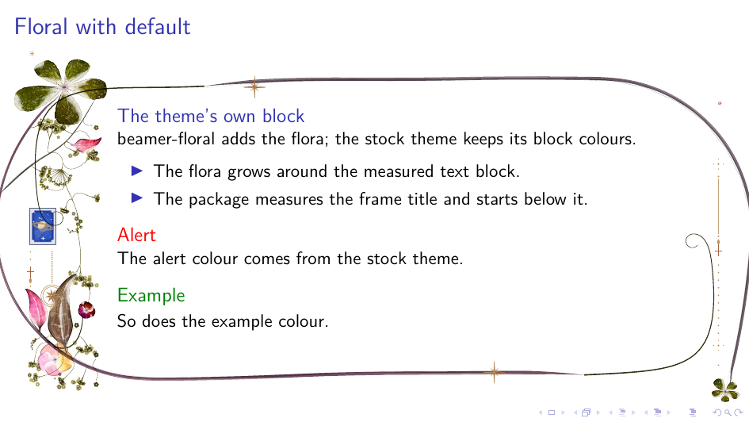

# Themes

The floral theme on its own, and the package with a stock theme.

## The floral theme



*Warm palette: a gold hero, warm blooms and earth foliage. The block accent
is momiji, the alert yama-budo and the example yama-guri.*



*Blue palette: blooms, leaves and leaflets in the iroshizuku blues. Alerts
use murasaki-shikibu and examples tsuki-yo.*



*Green palette: blue blooms with green foliage. Alerts use edo-murasaki and
examples chiku-rin.*



*A title page with the left layout: the flora fills the left margin and the
foot, leaving the right margin paper.*

The floral theme selects this fuller composition automatically for
`\titlepage`: `layout=left`, `density=2`, and leaf, leaflet, spray and bloom
weights of 3. Ordinary frames retain the document's settings. Override the
title preset with `\florathisframe{layout=...,density=...,mix={...}}` before
the title frame. This also applies to static titles; animation stays optional.
The first displayed overlay selects the preset for the whole frame: a title
shown only on a later overlay does not change the composition mid-frame.
See [the full animated title example](../src/growth-title.tex), which uses
the default eight-second duration and the optional raster cache.

## With a stock theme

Themes with sidebars or other theme content in the page margins, such as
Berkeley, are **not visually supported**: their margin panels can cover the
flora. The package warns when a Beamer sidebar is present. Prefer floral or a
theme with free side margins; alternatively switch the flora off on those
frames.

The package empties the `background canvas` template, since a filled canvas
would cover the flora. For a coloured page use `\pagecolor`. On a dark page
combine it with `\florasetup{backdrop=dark}` and light text colours.
With `show notes on second screen`, the notes panel covers the flora on that
side. In a `beamerarticle` document the floral commands do nothing.

Load the stock theme first and beamer-floral after it:

```tex
\usetheme{Madrid}
\usepackage{beamer-floral}
\florasetup{seed=3, density=1.2}
```

The package defaults to `header=body`: it measures the frame title and
starts the flora below it, while the stock theme keeps its own header,
block, alert and example colours. The border and stems are the floral
package's own.

Use `header=margin` when the theme leaves room in the left margin and you
want the hero beside the title instead:

```tex
\florasetup{header=margin, layout=surround}
```

`\usetheme{floral}` selects margin mode itself.



*Madrid keeps its blue header and block colours; the flora starts below the
frame title.*



*Berlin keeps its headline and footline; the flora fills the side margins
below the title.*



*The default theme with body mode: the border starts below the title.*
